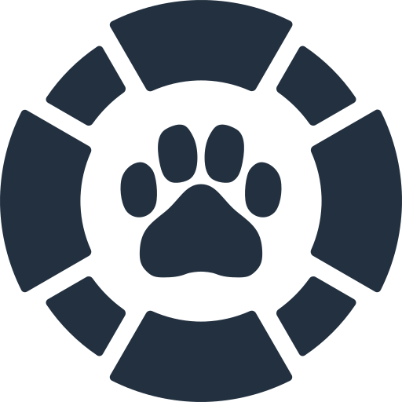

# Petscue <picture><source media="(prefers-color-scheme: dark)" srcset="logo_512_light.png"></picture>


## ¿Qué es Petscue?
Petscue es una plataforma base destinada a organizaciones de rescate y refugio animal en Chile, cuyo objetivo es darles a estas organizaciones (las cuales muchas veces cuentan con muy pocos recursos) una plataforma web donde puedan desarrollarse e implementar de mejor manera sus procesos internos con herramientas digitales que traigan el buen trabajo que ya hacen al mundo tecnológico de esta era.
Todo eso en una plataforma altamente configurable que le permita a cada organización tener su propio portal web.

Además, Petscue es el sucesor espiritual del proyecto universitario llamado [**Redcatando Animales**](https://github.com/Varrojalo/RedcatandoAnimales), con el mismo objetivo y una funcionalidad parecida.

## ¿Qué stack tecnológico usa Petscue? Y ¿Por qué?
Petscue está orientado a un uso de personas sin mucho conocimiento técnico tal que, inclusive si una organización tuviese en su equipo a un TI o programador/a, no deba tener tanto conocimiento técnico para entender, implementar y mantener la plataforma.
Además, como esta plataforma está pensada para organizaciones sin fines de lucro, las tecnologías utilizadas deben ser de código abierto y fácil acceso.

Dados estos motivos, el stack tecnológico es:
- **Backend:** Django (Python), Django Ninja (API)
- **Frontend:** ReactJS (JavaScript), Vite
- **Base de Datos:** PostgreSQL
- **Infraestructura:** Docker
- **Testing:** Vitest y pruebas de Django

### La IA y mi rol en el proyecto
En honor a la verdad he de aclarar que este proyecto fue desarrollado en su mayoría usando la IA de Claude y Claude Code como programador de la plataforma.

Sin embargo, **en ningún momento** se le dio libertad de decisión sobre el diseño y desarrollo del proyecto, ni la libertad de usar imágenes generadas. Todo esto ya que mi rol en este proyecto fue de Project Manager y Lead Designer del mismo, asegurándome de llevar las riendas del proyecto de la manera más ética y honesta posible en relación con mis valores y mi visión de crear un sucesor a un proyecto universitario que respetara los principios con los que este se concibió en su tiempo (proyecto que he de aclarar, nunca fue hecho usando IA).
#### Mi punto de vista acerca de las IAs generativas
Personalmente, estoy totalmente **en contra** del uso desmedido de la IA generativa, ya que se ha visto que esta tiene un impacto negativo en el medio ambiente, además de la gran falta de ética y moral por parte de varios usuarios y empresas que han provocado que muchas personas pierdan su trabajo.

Entonces, dicho eso **¡¿Por qué decidí usar Claude?!**

Simple, rapidez.

Desde que el proyecto Redcatando Animales quedó congelado y eventualmente cancelado, debido a la naturaleza de ser un proyecto universitario, este ha sido una deuda personal que he querido llevar a cabo, porque aún aprecio y creo en la noble tarea que hacen las organizaciones de rescate animal.
Por este motivo, si bien estoy en contra del uso de IAs generativas, decidí hacer uso de Claude para la parte técnica y dura del proyecto, dejando **TODAS** las decisiones creativas en mis manos para asegurarme de llevar el proyecto de la manera más ética posible (entendiendo completamente que lo mejor hubiese sido hacer el proyecto yo sin usar IA, pero entendiendo también que a veces es mejor una solución rápida que una perfecta, y que la solución que existe y ayuda es mejor que la que no existe).

## Avance del Proyecto
Actualmente, el proyecto está en ~55% de avance, y cuenta con:
- Mockup del proyecto final (véase "petscue-mockup.html" en ```/docs/mockups```).
- Frontend base de la página pública.
- Backend y modelo de datos (véase "modelo-de-datos.html" en ```/docs```).
- Panel interno: inicio de sesión, resumen y gestión de animales.
- 104 pruebas del backend y 29 del frontend.

### ¿Qué funciones tendrá Petscue?
- Catálogo de animales con fotos.
- Solicitudes de adopción.
- Socios, voluntarios y casas de acogida.
- Avisos de animales en la calle.
- Lista de restricciones por RUT.
- Panel interno con visitas.
- Importación desde Excel.
- Personalización de colores, logo y tipografía.

### ¿Qué falta?
- El sistema de respaldos nocturnos de BD.
- Guía de instalación para organizaciones.
- Manejo de correos.
- Completar el panel interno (solicitudes, verificar RUT, personas, avisos, apariencia, importación y respaldos).

## Cómo levantarlo
**Requisitos:**
- [Git](https://git-scm.com/)
- Terminal (En Windows click derecho en una carpeta y click en "Abrir en Terminal")
- WSL 2 (solo en Windows instálalo con ```wsl --install``` en Terminal en modo administrador)
- [Docker Desktop](https://www.docker.com/products/docker-desktop/)


**Pasos:**
1. Abre una Terminal en la carpeta donde quieras guardar el proyecto.
2. Clona el proyecto en la carpeta local con ```git clone https://github.com/Varrojalo/petscue.git``` usando la terminal
3. Entra en la carpeta petscue desde la terminal con ```cd petscue``` 
4. Copia **.env.example** a **.env** y cambia las claves ``` DJANGO_SECRET_KEY ``` y ```POSTGRES_PASSWORD```, que traen el texto *“cambia-esta-clave”*.
5. Abre Docker Desktop
6. Ejecuta ```docker compose up --build``` en la terminal (una vez ejecutado la terminal quedará ocupada)
7. Abre otra terminal en la carpeta "petscue".
8. Ejecuta ```docker compose exec backend python manage.py create_admin``` en la terminal nueva.
9. Una vez levantado el proyecto las direcciones son:
    - web (http://localhost:5173)
    - panel interno (http://localhost:5173/dashboard)
    - documentación de la API (http://localhost:8000/api/docs)

> **NOTAS:**
> 1. Docker en Windows necesita WSL y se debe instalar antes. Una vez WSL se instala se necesita reiniciar el computador para que la instalación funcione.
> 2. Si los puertos 5173 o 8000 están ocupados, cambia el número de la izquierda en ```docker-compose.yml```.
> 3. La instalación luego de docker compose tarda unos minutos, espera a que dejen de aparecer líneas nuevas.
> 4. Para apagar Petscue puedes hacerlo con **"CTRL + C"** en la terminal donde está funcionando.
> 5. Si quieres encenderlo otro día puedes usar ```docker compose up``` sin --build
> 6. Para más información véase guía de instalación (próximamente).

## Licencia
Petscue tiene licencia [MIT](https://opensource.org/license/mit) (Véase [LICENSE](./LICENSE))